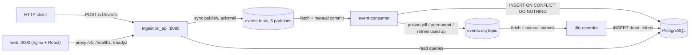
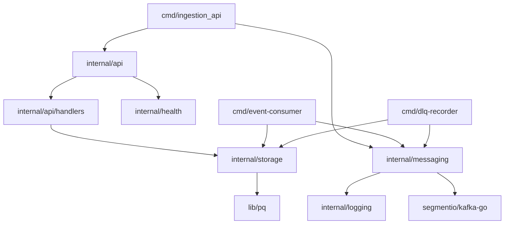
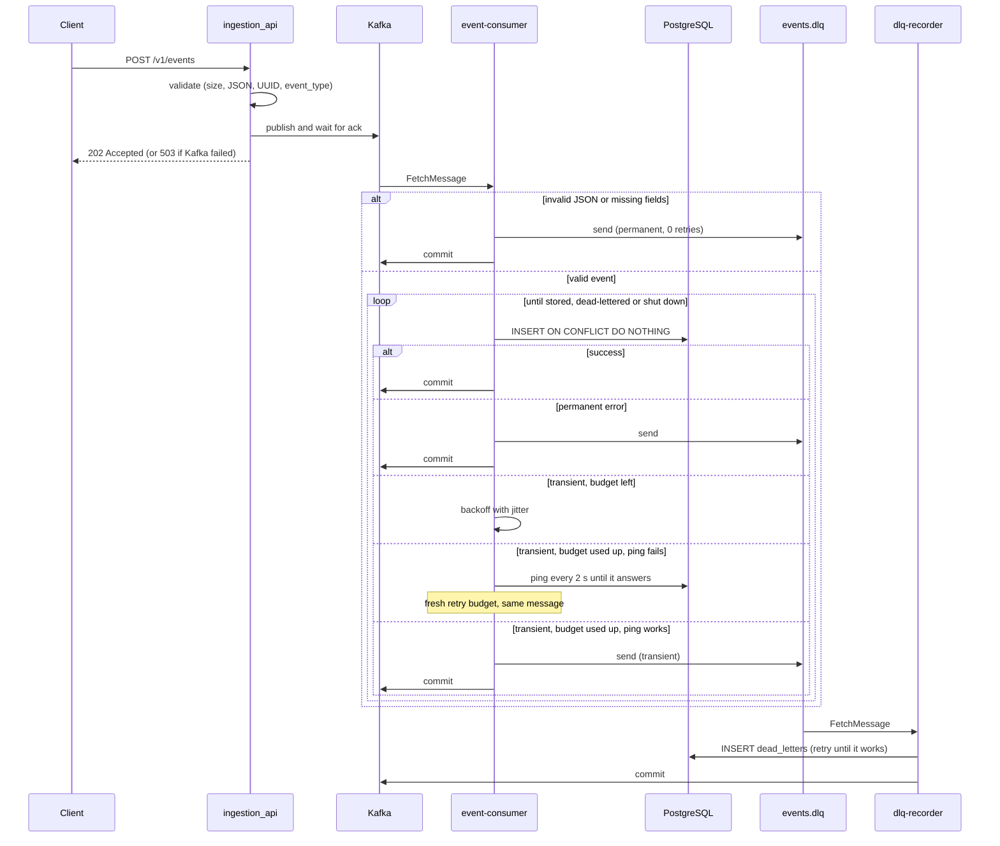

# Event Analytics Platform: Technical Notes

> **Last updated:** 2026-11-26
> **Stack:** Go 1.25 · Kafka (Confluent 7.5, single broker) · PostgreSQL 15 · React 18 + TypeScript + Vite · nginx
> **Style:** event-driven pipeline of three small Go services plus a dashboard

The [README](README.md) covers how to run it, the API, the guarantees and the failure demo.
This file explains how the parts fit together and why.

## Table of Contents

1. [System Overview](#1-system-overview)
2. [Components](#2-components)
3. [Data Model](#3-data-model)
4. [Execution Flow](#4-execution-flow)
5. [Key Design Decisions](#5-key-design-decisions)
6. [Failure Analysis](#6-failure-analysis)
7. [Security Considerations](#7-security-considerations)
8. [Frontend](#8-frontend)
9. [Known Limits and Next Steps](#9-known-limits-and-next-steps)

---

## 1. System Overview

The platform accepts events over HTTP, buffers them in Kafka and stores them in PostgreSQL with at-least-once delivery and idempotent writes. Messages that cannot be stored go to a dead-letter topic, are copied into Postgres, and are shown in the dashboard.



| Responsibility | Owner |
|---|---|
| Input validation, accepting events | `ingestion_api` |
| Durable buffer between API and database | Kafka topic `events` |
| Decode, store, retry, pause on outage, dead-letter | `event-consumer` (`messaging.Processor`) |
| Idempotent storage | PostgreSQL `events` table (primary key `event_id`) |
| Failed message isolation | Kafka topic `events.dlq` |
| Making dead letters queryable | `dlq-recorder` and the `dead_letters` table |
| Browsing events, analytics, dead letters | `web` dashboard |

---

## 2. Components

### Ingestion API (`cmd/ingestion_api`)

A chi HTTP server. On start it connects to Postgres, creates the Kafka producer, and serves until `SIGINT`/`SIGTERM`. Shutdown stops new connections, waits up to 10 seconds for in-flight requests, then closes the producer and the database pool.

`POST /v1/events` validation (`internal/api/handlers/event.go`):

| Rule | Response |
|---|---|
| Body larger than 64 KB (`http.MaxBytesReader`) | `413` |
| Not valid JSON, or more than one JSON value | `400` |
| `event_id` missing or not a UUID | `400` |
| `event_type` missing, blank, or longer than 64 characters | `400` |
| `payload` missing or `null` | stored as `{}` |
| Kafka write fails or takes more than 5 s | `503` |
| Kafka acknowledged the write | `202` with `event_id` |

Middleware: `RequestID` (reads or creates `X-Request-ID`), `Logging` (one JSON line per request with method, path, status and duration), and a permissive CORS header for the Vite dev server.

### Event consumer (`cmd/event-consumer`)

A loop: `FetchMessage` then `Processor.Process`. Messages are handled one at a time, in order. The decision logic lives in `internal/messaging/processor.go`, behind three small interfaces (`EventStore`, `DeadLetterWriter`, `OffsetCommitter`), so the tests run the real code against fakes.

### DLQ recorder (`cmd/dlq-recorder`)

Reads `events.dlq` with its own consumer group (`dlq-recorder-group`). For each message it parses the DLQ envelope, cleans text that Postgres TEXT columns reject (invalid UTF-8 and NUL), inserts a row into `dead_letters`, and only then commits the offset. Transient insert errors are retried until they succeed. A permanent error is logged with the full message and skipped, because there is no further DLQ.

### Messaging (`internal/messaging`)

| Part | Role |
|---|---|
| `Producer` | Writes to `events`, `RequiredAcks: all`, hash balancer on the key |
| `Consumer` | Reader with auto-commit off; a new group starts at the oldest offset |
| `DLQProducer` | Writes the DLQ envelope to `events.dlq` |
| `Processor` | Per-message rules: store, retry, pause, dead-letter, commit |
| `RetryConfig` | Exponential backoff with jitter and a retry budget |
| `Classify` | Transient or permanent, see section 6 |

### Storage (`internal/storage`)

A thin `database/sql` wrapper with `lib/pq`. Pool: 25 open, 5 idle, 5-minute lifetime.

| Method | Purpose |
|---|---|
| `InsertEvent` | `INSERT ... ON CONFLICT (event_id) DO NOTHING` |
| `GetEvents`, `GetEvent` | Paged and filtered event reads |
| `GetSummary`, `GetTypeCounts`, `GetTimeline` | Analytics |
| `InsertDeadLetter`, `ListDeadLetters` | Dead letters (idempotent on partition and offset) |
| `Ping` | Readiness and outage detection |

### Infrastructure (`docker-compose.yml`)

`zookeeper` and `kafka` (with healthchecks), `kafka-init` (creates `events` with 3 partitions and `events.dlq` with 1, then exits), `postgres` (healthcheck with `pg_isready`), `migrate` (golang-migrate applies `migrations/`, then exits), then `api`, `consumer`, `dlq-recorder` and `web`. Containers talk to `kafka:29092` and `postgres:5432`. Kafka auto topic creation is off. All Go services share one multi-stage `Dockerfile` with a `SERVICE` build arg and run as a non-root user.

### Dependencies between packages



`handlers` does not import `messaging`: it depends on a one-method `Publisher` interface, which `*messaging.Producer` satisfies.

---

## 3. Data Model

### Event (API body and Kafka value)

```json
{"event_id": "550e8400-e29b-41d4-a716-446655440000", "event_type": "click", "payload": {"page": "/home"}}
```

Kafka key: `event_id`. Value: the JSON above.

### Tables

```sql
-- migrations/000001
CREATE TABLE events (
    event_id    UUID PRIMARY KEY,
    event_type  VARCHAR(255) NOT NULL,
    payload     JSONB NOT NULL DEFAULT '{}',
    received_at TIMESTAMPTZ NOT NULL DEFAULT NOW()
);

-- migrations/000002
CREATE TABLE dead_letters (
    id              BIGSERIAL PRIMARY KEY,
    original_key    TEXT NOT NULL DEFAULT '',
    original_value  TEXT NOT NULL DEFAULT '',  -- TEXT, not JSONB: poison pills are not valid JSON
    error_kind      VARCHAR(32) NOT NULL,      -- transient | permanent | unknown
    error_message   TEXT NOT NULL DEFAULT '',
    retry_count     INT NOT NULL DEFAULT 0,
    failed_at       TIMESTAMPTZ NOT NULL,
    kafka_partition INT NOT NULL,              -- position in events.dlq
    kafka_offset    BIGINT NOT NULL,
    recorded_at     TIMESTAMPTZ NOT NULL DEFAULT NOW(),
    UNIQUE (kafka_partition, kafka_offset)
);
```

### DLQ envelope (value on `events.dlq`)

```go
type DLQMessage struct {
    OriginalTopic     string    `json:"original_topic"`
    OriginalPartition int       `json:"original_partition"`
    OriginalOffset    int64     `json:"original_offset"`
    OriginalKey       string    `json:"original_key"`
    OriginalValue     string    `json:"original_value"` // raw bytes as text
    ErrorMessage      string    `json:"error_message"`
    ErrorKind         string    `json:"error_kind"`
    Retries           int       `json:"retries"`
    FailedAt          time.Time `json:"failed_at"`
}
```

`OriginalValue` is a string on purpose. As `json.RawMessage`, an invalid-JSON message could not be marshalled, so poison pills could never reach the DLQ.

### Invariants

1. `event_id` is unique and chosen by the client. Idempotency depends on it.
2. An event is accepted when Kafka acknowledges it, not when it reaches Postgres.
3. An offset is committed only after the event is in Postgres or in `events.dlq`.
4. The payload is opaque. Only Postgres can reject it (for example `\u0000`, which JSONB cannot store).

---

## 4. Execution Flow



A failed DLQ send is retried with backoff and the offset is not committed until it succeeds. On shutdown, any wait (backoff, outage pause, DLQ retry) returns at once without a commit.

---

## 5. Key Design Decisions

| Decision | Why | Cost |
|---|---|---|
| Synchronous publish in the API | `202` means Kafka has the event, so a crash cannot lose it | Each request waits for the Kafka ack (a few ms locally) |
| Manual offset commit after the write | A crash causes a replay, not a loss | Duplicates are possible, so writes must be idempotent |
| `ON CONFLICT DO NOTHING` on `event_id` | Replays are harmless | Clients must send unique UUIDs |
| Pause on outage instead of dead-lettering | An outage is not the message's fault, and the DLQ should hold only bad messages | One partition waits while the database is down |
| DLQ through Kafka, recorded by a separate service | Postgres may be the thing that is down when the consumer dead-letters | One more small service |
| SQLSTATE-based classification | Codes are stable, error text is not | Errors without a code still fall back to text matching |
| Hash balancer, 3 partitions | Same key, same partition, so one event is handled in order; up to 3 consumers can share the load | Ordering holds only within a partition |
| Liveness separate from readiness | A database outage should not restart the API | `/readyz` returns 503 during the outage while ingestion still works |

**Scaling.** The API is stateless and can run as many copies as needed. Consumers scale inside the consumer group up to the partition count (`docker compose up -d --scale consumer=3` was tested and shares the work). Postgres is the eventual bottleneck: there are no replicas or table partitioning.

**Observability.** JSON log lines with `time`, `level`, `service` and `message`; request IDs through `X-Request-ID`; error kind on every failure log; the DLQ envelope keeps the original message. There are no metrics or tracing yet.

---

## 6. Failure Analysis

| Failure | What the system does | Visible as |
|---|---|---|
| Invalid request | `400`/`413`, nothing published | JSON error to the client |
| Kafka down when the API publishes | `503`, nothing accepted | Client retries |
| Invalid JSON or missing fields in Kafka | DLQ at once, commit | Dead Letters page, `error_kind: permanent` |
| Postgres rejects the value (SQLSTATE 22, 23) | DLQ after 1 attempt, commit | Dead Letters page |
| Postgres down for a short time | Retries with backoff, then stores | `insert failed` logs, then `event persisted` |
| Postgres down for longer than the retry budget | Pauses, pings every 2 s, then stores | `database unreachable, pausing...` and `database is back, resuming` |
| Repeated transient error while Postgres is healthy | DLQ with `error_kind: transient` | Dead Letters page |
| DLQ write fails | Retry with backoff, no commit | `DLQ write failed, retrying` logs |
| Consumer crash before commit | Message delivered again, insert is a no-op if it was stored | Nothing lost, no duplicate row |
| Postgres down for the recorder | Retries until it works, no commit | Dead letters appear once Postgres is back |

Classification order in `Classify`: explicit `ProcessingError`, then SQLSTATE code (class `22` and `23` permanent, all other codes transient), then network and I/O errors (transient), then known text for errors without a code, then unknown (transient).

---

## 7. Security Considerations

| Area | Status |
|---|---|
| Body size | Limited to 64 KB |
| `event_id` / `event_type` | Validated (UUID, 1 to 64 characters) |
| Payload | Any JSON, not inspected |
| SQL | Parameterized queries only; paging values are clamped and passed as parameters |
| Authentication, rate limiting | **Not implemented.** The API is open |
| CORS | `Access-Control-Allow-Origin: *`, meant for local development |
| Transport | No TLS (Kafka PLAINTEXT, Postgres `sslmode=disable`). Local only |
| Secrets | Development credentials are in `docker-compose.yml` and as defaults in `config.go` |
| Containers | Go services run as a non-root user in Alpine images |
| Data in the DLQ | Original payloads are kept and may contain personal data |

---

## 8. Frontend

React 18 + TypeScript, built by Vite, in `web/`. In Docker, nginx serves `dist/` and proxies `/v1`, `/healthz` and `/readyz` to `api:8080`, so the browser talks to one origin. In development, the Vite server on port 3000 proxies the same paths to `localhost:8080`.

| Page | Route | Data |
|---|---|---|
| Dashboard | `/` | `GET /v1/analytics/summary`, `/timeline?hours=24`, `/types`, `/v1/events?limit=10` |
| Events | `/events` | `GET /v1/events` with filters and paging; **Send test event** and **Send bad event** buttons (`POST /v1/events`) with a toast |
| Event detail | `/events/:id` | `GET /v1/events/{id}` |
| Analytics | `/analytics` | Timeline (6 h to 7 d), pie and bar charts |
| Dead Letters | `/dlq` | `GET /v1/dlq` with paging, empty state, refresh every 3 s, click a row to see the original message |

The header polls `/healthz` every 30 seconds. "Send bad event" posts a payload containing `\u0000`: valid JSON that the API accepts, but that a JSONB column cannot store (SQLSTATE `22P05`), so it ends up in the DLQ.

---

## 9. Known Limits and Next Steps

| Limit | Next step |
|---|---|
| Single Kafka broker, replication factor 1 | 3 brokers, replication factor 3, `min.insync.replicas=2` |
| No metrics | Prometheus counters (accepted, stored, retried, dead-lettered), consumer lag |
| Consumer and recorder have no health endpoint | Small `/healthz` server in both |
| No DLQ replay | `POST /v1/dlq/{id}/replay` and a dashboard button |
| No authentication or rate limiting | API keys and a token-bucket limiter |
| One message at a time per consumer | Batch inserts if throughput becomes a problem |
| No frontend unit tests | Vitest for the API client and the DLQ page |
