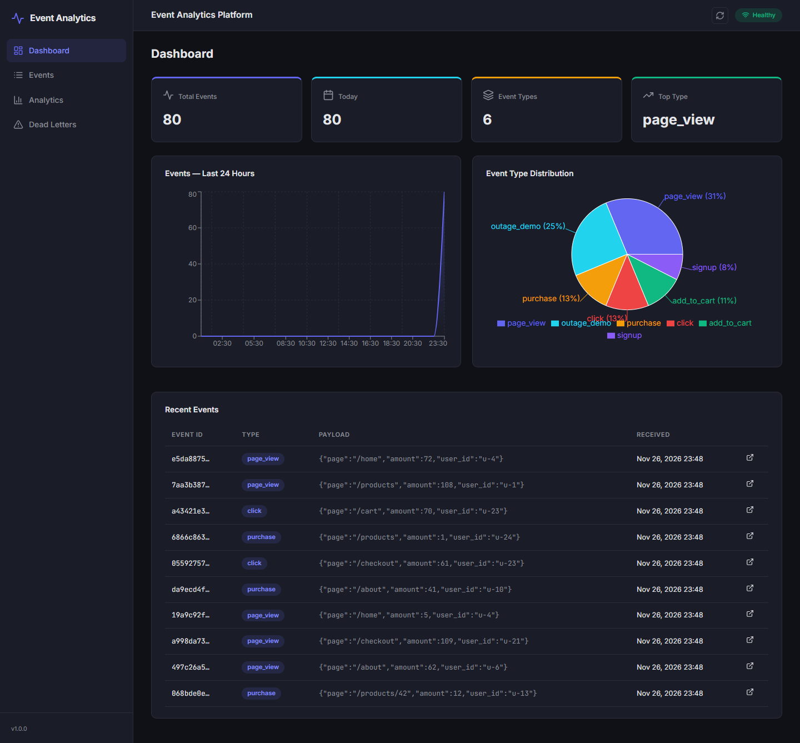
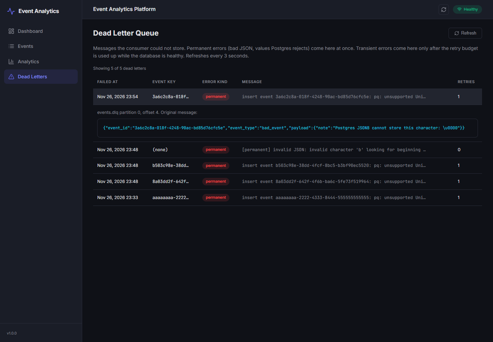
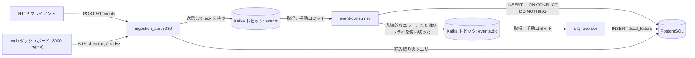

# Event Analytics Platform（イベント分析プラットフォーム）

[English](README.md) | 日本語

[](https://github.com/Karthik0000007/Event_Analytics_Platform/actions/workflows/ci.yml)

Go で作ったイベント収集のパイプラインです。クライアントは HTTP でイベントを送ります。API は、Kafka がイベントを保存したあとでだけ `202 Accepted` を返します。コンシューマーは、イベントを一つずつ PostgreSQL に書き込みます。この書き込みは冪等（べきとう）なので、同じイベントが何回届いても一行だけ保存されます。Kafka のオフセットは、書き込みが終わったあとでコミットします。

失敗は「一時的なエラー」と「永続的なエラー」に分けます。一時的なエラーはリトライします。データベースが止まっているときは、コンシューマーが一時停止して待ちます。永続的なエラーは、デッドレター用のトピックに送ります。小さな recorder サービスがデッドレターを Postgres にコピーするので、React のダッシュボードで、イベントと分析と失敗したメッセージを見ることができます。

すべてのサービスは一つのコマンドで起動します。データベースを止めるデモで、イベントが一件もなくならないことを何度でも確認できます。






> スクリーンショットと GIF について：何を撮るかは [docs/README.md](docs/README.md) を見てください。

---

## クイックスタート

必要なもの：Docker Desktop（または Compose v2 が使える Docker Engine）

```bash
docker compose up --build
```

最初のビルドは数分かかります。起動したら、次の URL を開きます。

| 何 | URL |
|---|---|
| ダッシュボード | http://localhost:3000 |
| API | http://localhost:8080 |
| Liveness / Readiness | http://localhost:8080/healthz, http://localhost:8080/readyz |

イベントを一つ送ります。

```bash
curl -X POST http://localhost:8080/v1/events \
  -H "Content-Type: application/json" \
  -d '{"event_id":"550e8400-e29b-41d4-a716-446655440000","event_type":"click","payload":{"page":"/home"}}'
```

Postgres に保存されたか確認します。

```bash
docker compose exec postgres psql -U events_user -d events_db -c "SELECT * FROM events;"
```

ダッシュボードで **Events** を開いて、**Send test event** か **Send bad event** を押してください。bad event は、数秒で **Dead Letters** のページに表示されます。

`docker compose down` で、すべて止まります。データベースのボリュームも消したいときは、`-v` を付けます。

---

## アーキテクチャ



| サービス | 役割 |
|---|---|
| `ingestion_api` | イベントをチェックして、Kafka に送ります。読み取り用のエンドポイントと `GET /v1/dlq` も提供します。 |
| `event-consumer` | `events` を読んで、`events` テーブルに書きます。リトライ、障害中の一時停止、悪いメッセージを DLQ に送ることもします。 |
| `dlq-recorder` | `events.dlq` を読んで、`dead_letters` テーブルに書きます。 |
| `web` | React + TypeScript のダッシュボードです。Vite でビルドして、nginx が配信します。nginx は API への呼び出しを転送します。 |
| `kafka-init`, `migrate` | 一回だけ動くジョブです。二つのトピックを作って、SQL のマイグレーションを適用します。 |
| `kafka`, `zookeeper`, `postgres` | インフラです（ローカル用で、Kafka のブローカーは一台です）。 |

詳しい説明は [ARCHITECTURE.md](ARCHITECTURE.md)（英語）にあります。

---

## API

| メソッドとパス | 説明 | ステータスコード |
|---|---|---|
| `POST /v1/events` | イベントを一つ受け取ります。ボディ：`event_id`（UUID）、`event_type`（1〜64 文字）、`payload`（どんな JSON でもよい、なくてもよい）。ボディは最大 64 KB です。 | `202` Kafka に保存した、`400` 入力が正しくない、`413` ボディが大きすぎる、`503` Kafka が使えない |
| `GET /v1/events` | イベントの一覧。クエリ：`type`、`from`、`to`（RFC 3339）、`limit`（最大 200）、`offset` | `200`、`500` |
| `GET /v1/events/{id}` | イベントを一つ | `200`、`400` id が UUID ではない、`404`、`500` |
| `GET /v1/analytics/summary` | イベントの合計、今日の数、種類の数、上位 5 つの種類 | `200`、`500` |
| `GET /v1/analytics/types` | 種類ごとのイベント数 | `200`、`500` |
| `GET /v1/analytics/timeline?hours=24` | 1 時間ごとのイベント数（1〜720 時間）。1 時間に一つの点があり、イベントがない時間は 0 です。 | `200`、`500` |
| `GET /v1/dlq?limit=50&offset=0` | デッドレターの一覧。新しい順です（limit は最大 100）。 | `200`、`500` |
| `GET /healthz` | Liveness：プロセスが動いている | `200` |
| `GET /readyz` | Readiness：Postgres が ping に答える | `200`、`503` |

エラーは JSON で返します。例：`{"error": "event_type must be at most 64 characters"}`

---

## 配信の保証

| 保証 | しくみ |
|---|---|
| **少なくとも一回の配信（at-least-once）** | API は、Kafka への書き込みが確認されたあと（`RequiredAcks: all`）でだけ `202` を返します。コンシューマーは、イベントが Postgres か DLQ に入ったあとでだけ、オフセットをコミットします。コミットの前に何かが落ちたら、Kafka が同じメッセージをもう一度届けます。 |
| **冪等な INSERT** | `INSERT ... ON CONFLICT (event_id) DO NOTHING` を使います。もう一度届いたイベントは、二行目を作りません。だから、少なくとも一回の配信でも、`event_id` ごとに一行になります。 |
| **書き込みのあとでオフセットをコミット** | Kafka の自動コミットはオフです。`CommitMessage` は、INSERT（または DLQ への書き込み）が成功したあとでだけ呼びます。 |
| **データベース障害でもなくならない** | リトライを使い切って、ping で Postgres が止まっているとわかったら、コンシューマーは一時停止します。データベースが戻ったら、同じメッセージをもう一度試します。そのあいだ、メッセージは Kafka の中で待っています。下の障害デモで確認できます。 |
| **DLQ への書き込みが失敗してもなくならない** | `events.dlq` への書き込みが失敗したら、コンシューマーはリトライを続けます。オフセットはコミットしません。 |
| **安全なシャットダウン** | `SIGINT`/`SIGTERM` で context がキャンセルされます。API は、処理中のリクエストを最大 10 秒待ちます。リトライ中に止まったコンシューマーはコミットしないで終わるので、再起動のあとでメッセージがもう一度処理されます。 |
| **DLQ の記録も冪等** | `dead_letters` テーブルには `UNIQUE (kafka_partition, kafka_offset)` があります。だから、もう一度届いた DLQ メッセージも一回だけ保存されます。 |

**制限。** ローカル環境の Kafka は、ブローカー一台、レプリケーション係数 1 です。そのため、Kafka のディスクが壊れると、データもなくなります。本番では、少なくとも 3 台のブローカーが必要です。冪等性は `event_id` に頼っているので、クライアントは一意（いちい）の UUID を送る必要があります。

---

## エラーの分類

コンシューマーは、失敗するたびに、リトライするかどうかを決めます。`messaging.Classify` は、次の順番でチェックします。

| チェック | 例 | 種類 | どうなるか |
|---|---|---|---|
| INSERT の前のデコードエラー | 正しくない JSON、`event_id` か `event_type` がない | 永続的 | すぐに DLQ へ。リトライは 0 回 |
| Postgres の SQLSTATE クラス `22`（データ例外） | `22P05` JSONB の中の `\u0000`、`22P02` 正しくないテキスト | 永続的 | 1 回試して DLQ へ |
| Postgres の SQLSTATE クラス `23`（制約違反） | `23505` 一意制約、`23514` チェック制約 | 永続的 | 1 回試して DLQ へ |
| そのほかの SQLSTATE | `08006` 接続が切れた、`57P01` 管理者によるシャットダウン、`57P03` 起動中、`40P01` デッドロック | 一時的 | リトライ |
| ネットワークや I/O のエラー | DNS の失敗、接続の拒否やリセット、EOF | 一時的 | リトライ |
| コードがないエラー | `unique constraint` や `invalid input syntax` という文字 | 永続的 | DLQ へ |
| わからないエラー | | 一時的 | リトライ（捨てるより、リトライするほうが安全だから） |

**一時的なエラーのリトライ**は、ジッター付きの指数バックオフを使います。最初は 200 ms で、1 回ごとに 2 倍になり、最大 10 秒です。`MAX_RETRIES` のデフォルトは 5 です。リトライを使い切ったら、次のようになります。

- Postgres が ping に**答えない**ときは、データベースが止まっています。コンシューマーは一時停止して、2 秒ごとに ping します。戻ったら、同じメッセージを新しいリトライ回数でもう一度試します。
- Postgres が ping に**答える**ときは、メッセージそのものに問題があります。そのメッセージは `error_kind: transient` として DLQ に送られます。

---

## 障害デモ：データベースを止める

サービスが動いている状態（`docker compose up --build -d`）で、次を実行します。

```powershell
# Windows PowerShell
powershell -ExecutionPolicy Bypass -File .\scripts\demo-db-outage.ps1
```

```bash
# Linux、macOS、Git Bash
./scripts/demo-db-outage.sh
```

このスクリプトは、まず行の数を数えます。次に Postgres のコンテナを止めて、イベントを 20 件送ります。10 秒待ってから Postgres をもう一度起動し、コンシューマーが追いつくまで待って、もう一度数えます。結果は次のようになります（行の数は、前のデータによって変わります）。

```text
==> 3. Sending 20 events while the database is down
API accepted 20 of 20 events with 202 while postgres was down
readiness during outage: HTTP 503 (503 expected)
...
==> Result
rows before:            1
rows after:             21
new rows:               20
demo events stored:     20 of 20
demo events in the DLQ: 0
PASS: exactly 20 new rows arrived (no loss, no duplicates)
```

中で起きていること：

1. API は `202` を返し続けます。API に必要なのは Kafka だけだからです。`/readyz` は `503` を返します。読み取りのエンドポイントには Postgres が必要だからです。
2. コンシューマーは最初のイベントの INSERT に失敗して、バックオフしながらリトライします。イベントはコミットされないまま、Kafka の中で待ちます。
3. Postgres が戻ると INSERT が成功して、コンシューマーはたまったイベントを順番に処理します。

障害が長いとき（1 分ぐらい）は、リトライを使い切ります。そのときログに `database unreachable, pausing until it recovers` と出て、あとで `database is back, resuming` と出ます。それでもイベントは保存されて、DLQ には何も入りません。

---

## テストの実行

```bash
gofmt -l .          # 何も表示されなければ OK
go vet ./...
go test ./...       # Linux や macOS では -race も付けられます（cgo が必要）
```

テストは **52 個のテスト関数（テーブル駆動のサブテストを入れると 71 回の実行）** で、すべて成功します。Kafka も Postgres も必要ありません。コンシューマーのロジックは、フェイク（にせもの）を相手に動きます。

| パッケージ | テスト数 | 何をテストするか |
|---|---|---|
| `internal/messaging` | 34 | SQLSTATE コードを含むエラーの分類、リトライとバックオフ、DLQ のエンベロープ、本物の `Processor` を使った 11 の障害シナリオ（ポイズンピル、一時的なエラーからの回復、リトライの使い切り、永続的なエラー、データベース障害での一時停止、DLQ への書き込み失敗、リトライ中のシャットダウン） |
| `internal/api/handlers` | 7（+12 サブテスト） | 入力チェックの表、Kafka が止まっているときの 503、`GET /v1/dlq` のページング |
| `internal/storage` | 3（+5 サブテスト） | デッドレターのクエリ作成、ページングの上限、冪等な INSERT の SQL |
| `cmd/dlq-recorder` | 4 | DLQ のエンベロープからテーブルの行への変換、読めないエンベロープ、Postgres が受け付けない文字の掃除 |
| `internal/health` | 2（+2 サブテスト） | Liveness、データベースが動いているときと止まっているときの Readiness |
| `internal/logging` | 2 | 一行に一つの JSON |

フロントエンドには単体テストがありません。CI は `npm run build` で型チェックとビルドをします。

CI（[.github/workflows/ci.yml](.github/workflows/ci.yml)）は、push と pull request のたびに動きます。gofmt のチェック、`go vet`、`go test -race`、web のビルドをします。

---

## Go のコードを Docker なしで動かす（ローカル開発）

```bash
docker compose up -d kafka kafka-init postgres migrate   # インフラだけ起動
go run ./cmd/ingestion_api                               # ターミナル 1
go run ./cmd/event-consumer                              # ターミナル 2
KAFKA_GROUP_ID=dlq-recorder-group go run ./cmd/dlq-recorder   # ターミナル 3
cd web && npm install && npm run dev                     # ターミナル 4、http://localhost:3000
```

デフォルトの接続先は `localhost:9093`（Kafka）と `localhost:5432`（Postgres）です。

| 環境変数 | デフォルト | 使うもの |
|---|---|---|
| `PORT` | `8080` | API |
| `SERVICE_NAME` | `ingestion-api` | API（ログの項目） |
| `KAFKA_BROKERS` | `localhost:9093` | すべて |
| `KAFKA_TOPIC` | `events` | API、コンシューマー |
| `KAFKA_DLQ_TOPIC` | `events.dlq` | コンシューマー、recorder |
| `KAFKA_GROUP_ID` | `event-consumer-group` | コンシューマー、recorder（recorder では `dlq-recorder-group` を使う） |
| `MAX_RETRIES` | `5` | コンシューマー |
| `DB_HOST`、`DB_PORT`、`DB_USER`、`DB_PASSWORD`、`DB_NAME` | `localhost`、`5432`、`events_user`、`events_password`、`events_db` | API、コンシューマー、recorder |

シェルですでに設定されている環境変数は、デフォルトより優先されます。ほかのプロジェクトで `KAFKA_BROKERS=localhost:9092` を設定している場合は、`KAFKA_BROKERS=localhost:9093` を付けて実行してください。

---

## 設計の判断

**なぜ Kafka を使うのか。** Kafka を使うと、「イベントを受け取ること」と「イベントを保存すること」を分けられます。Postgres が遅いときや止まっているときも、API は速いままで、イベントを受け取り続けられます。Kafka は、コンシューマーが追いつくまで、イベントをディスクに保存しておきます。また、コンシューマーグループを使えば、複数のコンシューマーで仕事を分けられます。

**なぜオフセットを手動でコミットするのか。** 自動コミットだと、Postgres に入る前に、Kafka がメッセージを「終わった」と記録するかもしれません。そのときに落ちると、メッセージがなくなります。書き込みのあとでだけコミットすれば、落ちてもメッセージはなくならず、もう一度処理されるだけです。INSERT が冪等なので、もう一度処理しても問題ありません。

**なぜ dlq-recorder を別にするのか。なぜ DLQ の記録はまず Kafka を通るのか。** コンシューマーがメッセージを DLQ に送る理由は、Postgres の問題であることが多いです。つまり、止まっているのは Postgres かもしれません。だから、失敗はまず Kafka のトピックに書いて、安全に保存します。データベースが元気になったら、recorder がそれを Postgres にコピーします。サービスを分けると、コンシューマーもシンプルになります。また、あとで DLQ を再送したり、ほかのツールで読んだりすることもできます。

**なぜ API は同期で送信するのか。** 前のバージョンは、バックグラウンドの goroutine で送信して、すぐに `202` を返していました。そのため、Kafka が失敗すると、イベントは何も言わずに消えていました。今は `202` が「Kafka が受け取った」という意味です。Kafka が止まっているときは、クライアントは `503` を受け取って、リトライできます。

**なぜパーティションとハッシュを使うのか。** `events` トピックには 3 つのパーティションがあります。プロデューサーは、キー（`event_id`）のハッシュでパーティションを選びます。だから、もう一度届いたイベントや重複したイベントも同じパーティションに入って、一つのコンシューマーが順番に処理します。順番が守られるのはパーティションの中だけで、トピック全体ではありません。スケールするときは、パーティションの数までコンシューマーを増やします：`docker compose up -d --scale consumer=3`

**なぜ Liveness と Readiness を分けるのか。** `/healthz` は依存先をチェックしません。だから、データベースが止まっても API は再起動されません。`/readyz` は Postgres をチェックします。読み取りのエンドポイントには Postgres が必要だからです。

---

## 次に改善したいこと

- **メトリクスとコンシューマーのヘルスチェック。** 受け取った数、保存した数、リトライした数、DLQ に送った数を数える Prometheus のカウンターと、コンシューマーの遅れ（lag）を追加したいです。コンシューマーと recorder にも `/healthz` を付けたいです。
- **DLQ の再送。** 直したメッセージを `events` にもう一度送る `POST /v1/dlq/{id}/replay` と、ダッシュボードのボタンを追加したいです。
- **本番向けの構成。** Kafka をブローカー 3 台、レプリケーション係数 3 で動かしたいです。API キー、レート制限、サービス間の TLS も追加したいです。

---

## プロジェクトの構成

```text
cmd/
  ingestion_api/       HTTP API：入力チェック、Kafka への送信、読み取り、安全なシャットダウン
  event-consumer/      Kafka のコンシューマーのループ（messaging.Processor を使う）
  dlq-recorder/        events.dlq を dead_letters テーブルにコピー
internal/
  api/                 ルーター、ハンドラー、ミドルウェア（リクエスト ID、JSON のリクエストログ）
  config/              環境変数からの設定
  health/              /healthz と /readyz
  logging/             一行に一つの JSON を書くロガー
  messaging/           プロデューサー、コンシューマー、DLQ プロデューサー、Processor、リトライ、エラーの分類
  storage/             PostgreSQL のクエリ（イベントとデッドレター）
migrations/            SQL のマイグレーション（migrate サービスが適用）
scripts/               データベース障害のデモ（PowerShell と bash）
web/                   React + TypeScript + Vite のダッシュボード、Dockerfile、nginx.conf
Dockerfile             すべての Go サービス用の一つのマルチステージイメージ（ビルド引数 SERVICE）
docker-compose.yml     システム全体
```

---

## 用語集

| 用語 | 読み方 | 意味 |
|---|---|---|
| 冪等（な処理） | べきとう | 同じ処理を何回しても、結果が同じになること（idempotent） |
| 少なくとも一回の配信 | すくなくとも いっかいの はいしん | メッセージは必ず届くが、二回届くこともある（at-least-once） |
| 一時的なエラー | いちじてきな エラー | 時間がたてば直るかもしれないエラー。リトライする（transient） |
| 永続的なエラー | えいぞくてきな エラー | 何回試しても直らないエラー。DLQ に送る（permanent） |
| 障害 | しょうがい | システムの一部が止まったり、壊れたりすること（outage, failure） |
| 制約違反 | せいやく いはん | データベースのルールに合わないデータ（constraint violation） |
| 一意 | いちい | ほかと同じものがないこと（unique） |
| 指数バックオフ | しすう バックオフ | リトライのたびに、待つ時間を 2 倍にすること（exponential backoff） |
| 依存先 | いぞんさき | そのサービスが動くために必要なほかのサービス（dependency） |
| 重複 | ちょうふく | 同じものが二つ以上あること（duplicate） |
