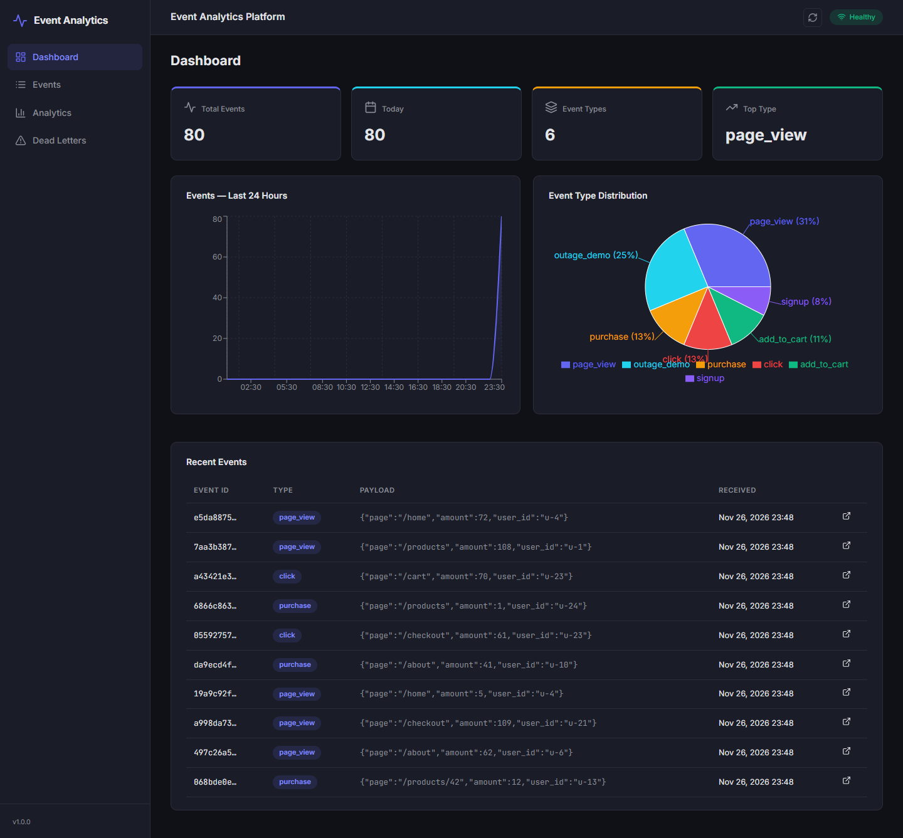
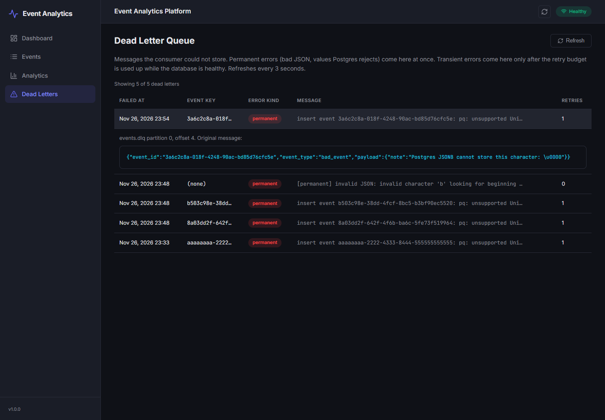
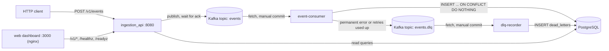

# Event Analytics Platform

English | [日本語](README.ja.md)

[](https://github.com/Karthik0000007/Event_Analytics_Platform/actions/workflows/ci.yml)

An event ingestion pipeline written in Go. Clients send events over HTTP. The API answers `202 Accepted` only after Kafka has stored the event. A consumer writes each event to PostgreSQL with an idempotent insert and commits the Kafka offset only after the write. Failures are classified as transient or permanent: transient errors are retried, a database outage pauses the consumer, and permanent failures go to a dead-letter topic. A small recorder service copies dead letters into Postgres, so a React dashboard can show events, analytics and failed messages. The whole stack starts with one command, and a repeatable demo shows that a database outage loses no events.






> Screenshot and GIF placeholders: see [docs/README.md](docs/README.md) for what to capture.

---

## Quick start

Requirements: Docker Desktop (or Docker Engine with Compose v2).

```bash
docker compose up --build
```

The first build takes a few minutes. When it is ready:

| What | URL |
|---|---|
| Dashboard | http://localhost:3000 |
| API | http://localhost:8080 |
| Liveness / readiness | http://localhost:8080/healthz, http://localhost:8080/readyz |

Send an event:

```bash
curl -X POST http://localhost:8080/v1/events \
  -H "Content-Type: application/json" \
  -d '{"event_id":"550e8400-e29b-41d4-a716-446655440000","event_type":"click","payload":{"page":"/home"}}'
```

Check that it reached Postgres:

```bash
docker compose exec postgres psql -U events_user -d events_db -c "SELECT * FROM events;"
```

In the dashboard, open **Events** and press **Send test event** or **Send bad event**. The bad event appears on the **Dead Letters** page within a few seconds.

Stop everything with `docker compose down` (add `-v` to delete the database volume).

---

## Architecture



| Service | What it does |
|---|---|
| `ingestion_api` | Validates events, publishes them to Kafka, serves read endpoints and `GET /v1/dlq` |
| `event-consumer` | Reads `events`, writes to the `events` table, retries, pauses during outages, dead-letters bad messages |
| `dlq-recorder` | Reads `events.dlq`, writes to the `dead_letters` table |
| `web` | React + TypeScript dashboard, built with Vite and served by nginx, which proxies API calls |
| `kafka-init`, `migrate` | One-shot jobs: create the two topics, apply SQL migrations |
| `kafka`, `zookeeper`, `postgres` | Infrastructure (single Kafka broker, for local use) |

More detail: [ARCHITECTURE.md](ARCHITECTURE.md).

---

## API

| Method and path | Description | Status codes |
|---|---|---|
| `POST /v1/events` | Accept one event. Body: `event_id` (UUID), `event_type` (1 to 64 chars), `payload` (any JSON, optional). Max body 64 KB. | `202` stored in Kafka, `400` invalid input, `413` body too large, `503` Kafka unavailable |
| `GET /v1/events` | List events. Query: `type`, `from`, `to` (RFC 3339), `limit` (max 200), `offset` | `200`, `500` |
| `GET /v1/events/{id}` | One event | `200`, `400` id is not a UUID, `404`, `500` |
| `GET /v1/analytics/summary` | Total events, events today, distinct types, top 5 types | `200`, `500` |
| `GET /v1/analytics/types` | Event count per type | `200`, `500` |
| `GET /v1/analytics/timeline?hours=24` | Events per hour (1 to 720 hours), one point per hour, 0 for hours without events | `200`, `500` |
| `GET /v1/dlq?limit=50&offset=0` | Dead letters, newest first (limit max 100) | `200`, `500` |
| `GET /healthz` | Liveness: the process is up | `200` |
| `GET /readyz` | Readiness: Postgres answers a ping | `200`, `503` |

Errors are JSON: `{"error": "event_type must be at most 64 characters"}`.

---

## Delivery guarantees

| Guarantee | How |
|---|---|
| **At-least-once delivery** | The API answers `202` only after the Kafka write is acknowledged (`RequiredAcks: all`). The consumer commits an offset only after the event is in Postgres or in the DLQ. If anything crashes before the commit, Kafka delivers the message again. |
| **Idempotent insert** | `INSERT ... ON CONFLICT (event_id) DO NOTHING`. A redelivered event does not create a second row, so at-least-once delivery gives one row per `event_id`. |
| **Offset committed after the write** | Kafka auto-commit is off. `CommitMessage` is called only after the insert (or the DLQ write) succeeds. |
| **No loss during a database outage** | When retries run out and a ping shows Postgres is down, the consumer pauses and retries the same message when the database returns. Messages wait in Kafka. Proven by the failure demo below. |
| **DLQ write failures do not lose data** | If writing to `events.dlq` fails, the consumer keeps retrying and does not commit the offset. |
| **Safe shutdown** | `SIGINT`/`SIGTERM` cancels a context. The API drains requests for up to 10 seconds. A consumer stopped mid-retry exits without committing, so the message is replayed after a restart. |
| **Idempotent DLQ recording** | `dead_letters` has `UNIQUE (kafka_partition, kafka_offset)`, so a replayed DLQ message is stored once. |

**Limits.** The local stack has one Kafka broker with replication factor 1, so a lost Kafka disk loses data. A production setup needs at least 3 brokers. Clients must send unique UUIDs, because the idempotency model depends on `event_id`.

---

## Error classification

The consumer decides per failure whether to retry. Order of checks in `messaging.Classify`:

| Check | Examples | Kind | What happens |
|---|---|---|---|
| Decode error before insert | Invalid JSON, missing `event_id` or `event_type` | Permanent | Straight to DLQ, 0 retries |
| Postgres SQLSTATE class `22` (data exception) | `22P05` `\u0000` inside JSONB, `22P02` invalid text | Permanent | DLQ after 1 attempt |
| Postgres SQLSTATE class `23` (constraint violation) | `23505` unique, `23514` check | Permanent | DLQ after 1 attempt |
| Any other SQLSTATE | `08006` connection lost, `57P01` admin shutdown, `57P03` starting up, `40P01` deadlock | Transient | Retry |
| Network or I/O error | DNS failure, connection refused or reset, EOF | Transient | Retry |
| Errors without a code | Text like `unique constraint` or `invalid input syntax` | Permanent | DLQ |
| Anything unknown | | Transient | Retry, because retrying is safer than discarding |

**Transient retries** use exponential backoff with jitter: 200 ms base, x2 per attempt, capped at 10 s, `MAX_RETRIES=5` by default. When the budget is used up:

- if Postgres does **not** answer a ping, the database is down. The consumer pauses, pings every 2 s, then retries the same message with a fresh budget;
- if Postgres **does** answer, the message itself is the problem. It goes to the DLQ with `error_kind: transient`.

---

## Failure demo: stop the database

With the stack running (`docker compose up --build -d`):

```powershell
# Windows PowerShell
powershell -ExecutionPolicy Bypass -File .\scripts\demo-db-outage.ps1
```

```bash
# Linux, macOS or Git Bash
./scripts/demo-db-outage.sh
```

The script counts rows, stops the Postgres container, sends 20 events, waits 10 seconds, starts Postgres again, waits for the consumer to catch up, and counts again. Expected output (row counts depend on earlier data):

```text
==> 3. Sending 20 events while the database is down
API accepted 20 of 20 events with 202 while postgres was down
readiness during outage: HTTP 503 (503 expected)
...
==> Result
rows before:            1
rows after:             21
new rows:               20
demo events stored:     20 of 20
demo events in the DLQ: 0
PASS: exactly 20 new rows arrived (no loss, no duplicates)
```

What happens inside:

1. The API keeps answering `202`, because it only needs Kafka. `/readyz` answers `503`, because the read endpoints need Postgres.
2. The consumer fails to insert the first event and retries with backoff. The events wait in Kafka, uncommitted.
3. Postgres comes back, the insert succeeds, and the consumer drains the backlog in order.

On a longer outage (about a minute) the retry budget runs out. The log then shows `database unreachable, pausing until it recovers` and later `database is back, resuming`. The event is still stored and nothing goes to the DLQ.

---

## Running tests

```bash
gofmt -l .          # must print nothing
go vet ./...
go test ./...       # add -race on Linux or macOS (needs cgo)
```

The suite has **52 test functions (71 test runs including table-driven subtests)**. All pass. None of them needs Kafka or Postgres: the consumer logic runs against fakes.

| Package | Tests | What they cover |
|---|---|---|
| `internal/messaging` | 34 | Error classification incl. SQLSTATE codes, retry and backoff, DLQ envelope, 11 failure-injection scenarios on the real `Processor` (poison pill, transient recovery, retries used up, permanent error, database outage pause, DLQ write failure, shutdown mid-retry) |
| `internal/api/handlers` | 7 (+12 subtests) | Input validation table, 503 when Kafka is down, `GET /v1/dlq` paging |
| `internal/storage` | 3 (+5 subtests) | Dead-letter query building, paging limits, idempotent insert SQL |
| `cmd/dlq-recorder` | 4 | DLQ envelope to table row, unreadable envelopes, cleaning text Postgres rejects |
| `internal/health` | 2 (+2 subtests) | Liveness, readiness with database up and down |
| `internal/logging` | 2 | One JSON object per line |

The frontend has no unit tests. CI type-checks and builds it with `npm run build`.

CI ([.github/workflows/ci.yml](.github/workflows/ci.yml)) runs on every push and pull request: gofmt check, `go vet`, `go test -race`, and the web build.

---

## Local development without Docker for the Go code

```bash
docker compose up -d kafka kafka-init postgres migrate   # infrastructure only
go run ./cmd/ingestion_api                               # terminal 1
go run ./cmd/event-consumer                              # terminal 2
KAFKA_GROUP_ID=dlq-recorder-group go run ./cmd/dlq-recorder   # terminal 3
cd web && npm install && npm run dev                     # terminal 4, http://localhost:3000
```

The defaults point at `localhost:9093` (Kafka) and `localhost:5432` (Postgres).

| Variable | Default | Used by |
|---|---|---|
| `PORT` | `8080` | API |
| `SERVICE_NAME` | `ingestion-api` | API (log field) |
| `KAFKA_BROKERS` | `localhost:9093` | all |
| `KAFKA_TOPIC` | `events` | API, consumer |
| `KAFKA_DLQ_TOPIC` | `events.dlq` | consumer, recorder |
| `KAFKA_GROUP_ID` | `event-consumer-group` | consumer, recorder (use `dlq-recorder-group`) |
| `MAX_RETRIES` | `5` | consumer |
| `DB_HOST`, `DB_PORT`, `DB_USER`, `DB_PASSWORD`, `DB_NAME` | `localhost`, `5432`, `events_user`, `events_password`, `events_db` | API, consumer, recorder |

A variable already set in your shell wins over the default. If another project set `KAFKA_BROKERS=localhost:9092` on your machine, run with `KAFKA_BROKERS=localhost:9093`.

---

## Design decisions

**Why Kafka.** Kafka separates accepting an event from storing it. The API stays fast and keeps accepting events while Postgres is slow or down, and Kafka keeps them on disk until the consumer catches up. Kafka also lets several consumers share the work through a consumer group.

**Why manual offset commits.** With auto-commit, Kafka could mark a message as done before it is in Postgres, and a crash at that moment would lose it. Committing only after the write means a crash causes a replay instead of a loss. The idempotent insert makes the replay harmless.

**Why a separate dlq-recorder, and why DLQ records go through Kafka first.** The consumer often dead-letters a message because Postgres has a problem, so Postgres may be the thing that is down. Writing the failure to a Kafka topic first keeps it safe even then, and the recorder copies it into Postgres when the database is healthy. A separate service also keeps the consumer simple and lets the DLQ be replayed or read by other tools later.

**Why the API publishes synchronously.** An earlier version published in a background goroutine and returned `202` at once, so a Kafka failure lost the event silently. Now `202` means "Kafka has it", and the client gets `503` and can retry if Kafka is down.

**Why partitions and a hash balancer.** The `events` topic has 3 partitions, and the producer picks the partition by hashing the key (`event_id`). A redelivered or duplicate event lands on the same partition, so it is processed in order by one consumer. Ordering is guaranteed only inside a partition, not across the whole topic. To scale, run more consumers, up to one per partition: `docker compose up -d --scale consumer=3`.

**Why liveness and readiness are different.** `/healthz` never checks dependencies, so a database outage does not restart the API. `/readyz` checks Postgres, because the read endpoints need it.

---

## What I would improve next

- **Metrics and a consumer health endpoint.** Add Prometheus counters for accepted, stored, retried and dead-lettered events, plus consumer lag. Add `/healthz` to the consumer and recorder.
- **DLQ replay.** Add `POST /v1/dlq/{id}/replay` that republishes a fixed message to `events`, and a button for it in the dashboard.
- **Production setup.** Run 3 Kafka brokers with replication factor 3, add API keys and rate limiting, and use TLS between services.

---

## Project structure

```text
cmd/
  ingestion_api/       HTTP API: validation, Kafka publish, read endpoints, graceful shutdown
  event-consumer/      Kafka consumer loop, uses messaging.Processor
  dlq-recorder/        Copies events.dlq into the dead_letters table
internal/
  api/                 Router, handlers, middleware (request ID, JSON request logs)
  config/              Settings from environment variables
  health/              /healthz and /readyz
  logging/             JSON line logger
  messaging/           Producer, consumer, DLQ producer, Processor, retry, error classification
  storage/             PostgreSQL queries (events and dead letters)
migrations/            SQL migrations, applied by the migrate service
scripts/               Database outage demo (PowerShell and bash)
web/                   React + TypeScript + Vite dashboard, Dockerfile, nginx.conf
Dockerfile             One multi-stage image for all Go services (build arg SERVICE)
docker-compose.yml     The whole stack
```

---

## 日本語

日本語の README は [README.ja.md](README.ja.md) にあります。
